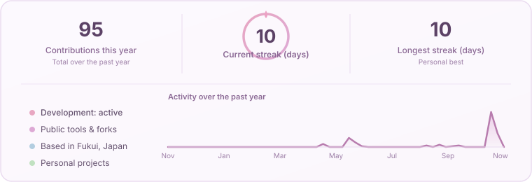

  <a href="https://github.com/r-fallingstar">日本語</a> · <strong>English</strong>

  

<h2 align="center">Hi, I'm R 🌠</h2>

  I'm interested in space, satellite imagery, Unity, VRChat, and AI tools. 
  I enjoy exploring new technologies and building personal projects and prototypes.

  

  
  
  
  
  
  
  

✧ ˚ · .　　　⋆　　　. · ˚ ✧

### 🪻 Interests

- 🛰️ **Space & satellite imagery**: I'm interested in space technology and what satellite data can tell us about Earth.
- 🎮 **Unity & VRChat**: I build things for virtual spaces and create tools to support that work.
- 🪄 **AI tools**: I use AI tools in development and everyday tasks, and explore practical ways to work with them.

### 🛰️ Projects

#### [Satellite_Image_Downloader](https://github.com/r-fallingstar/Satellite_Image_Downloader)
**Earth Imagery Studio**

A Japanese-language desktop app for downloading Sentinel-2 and Landsat optical satellite imagery through Google Earth Engine. Select an area on a map and save the imagery to your computer.

- Filter by date range and maximum cloud cover, then crop and download the area you need.
- Combine scenes from a selected period using mosaics or median composites.
- Export GeoTIFF files for analysis along with QGIS style files (.qml).

This repository is currently private; access is required to view it.

### 🌷 Forks & public tools

| Area | Repository | Description |
| :---: | :--- | :--- |
| 🎮 | [unity-mcp-alcom](https://github.com/r-fallingstar/unity-mcp-alcom) | A distribution fork of Unity MCP for installation and updates through ALCOM / VPM |
| 📝 | [mcp-youtube-transcript](https://github.com/r-fallingstar/mcp-youtube-transcript) | A fork of an MCP server for retrieving YouTube video transcripts |

 

### Support my work

I plan to keep my public tools free. Optional support helps cover development and testing costs so I can keep working on them.

[Support my work through GitHub Sponsors](https://github.com/sponsors/r-fallingstar)

Sponsorship is optional and does not include individual support or guaranteed feature requests.

### 📊 GitHub activity

  

 

  <a href="https://github.com/r-fallingstar?tab=repositories">View all repositories ↗</a>

 

  ✧ ˚ · .　Thanks for stopping by　. · ˚ ✧

