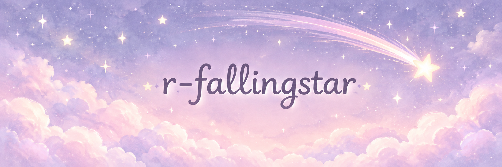
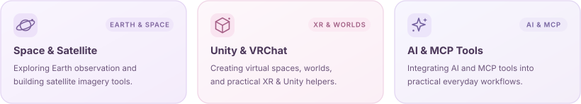
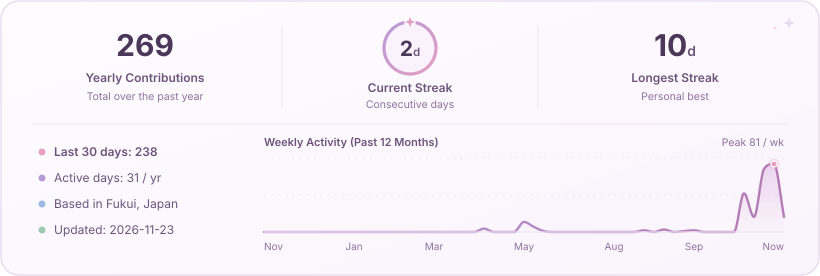

  <a href="https://github.com/r-fallingstar">日本語</a> &nbsp;·&nbsp; <strong>English</strong> &nbsp;·&nbsp; <a href="https://r-fallingstar.github.io/?lang=en">Portfolio ↗</a> &nbsp;·&nbsp; <a href="https://snow-moon-works.booth.pm/">BOOTH ↗</a>

  

<h2 align="center">Hi, I'm R 🌠</h2>

  Interested in space, satellite imagery, Unity / VRChat, and AI tools. 
  I enjoy exploring new technologies and building personal projects and practical tools.

  <picture>
    <source media="(prefers-color-scheme: dark)" srcset="./assets/focus-en-dark.svg" />
    <source media="(prefers-color-scheme: light)" srcset="./assets/focus-en-light.svg" />
    
  </picture>

  <picture>
    <source media="(prefers-color-scheme: dark)" srcset="./assets/tech-stack-dark.svg" />
    <source media="(prefers-color-scheme: light)" srcset="./assets/tech-stack-light.svg" />
    
  </picture>

  <picture>
    <source media="(prefers-color-scheme: dark)" srcset="./assets/divider-dark.svg" />
    <source media="(prefers-color-scheme: light)" srcset="./assets/divider-light.svg" />
    
  </picture>

### ✦ Projects

#### [VRC Asset Manager](https://booth.pm/ja/items/9201818) — *Windows App & Unity VPM Bridge*

A Windows desktop app for organizing VRChat avatar assets, outfits, hairstyles, tools, and textures in one library (free base edition with optional supporter edition).

- Manage ZIP archives, `.unitypackage` files, and extracted folders while linking them with BOOTH product pages and thumbnails.
- Organize by category, creator shop, tags, and notes—including custom or non-BOOTH assets.
- Pairs with the official VPM bridge (`com.fallingstar.vrc-asset-manager-bridge`) for one-click Unity imports and an "Installed Assets" visual tab inside Unity Editor.

[View on BOOTH ↗](https://booth.pm/ja/items/9201818) &nbsp;·&nbsp; [Unity VPM Page ↗](https://r-fallingstar.github.io/VRC-Asset-Manager-vpm/) &nbsp;·&nbsp; [Release Notes ↗](https://github.com/r-fallingstar/VRC-Asset-Manager-updates/releases)

#### [Satellite_Image_Downloader](https://github.com/r-fallingstar/Satellite_Image_Downloader) — *Earth Imagery Studio*

A Japanese-language desktop app for downloading Sentinel-2 and Landsat optical satellite imagery through Google Earth Engine. Select an area on a map and save the imagery to your computer.

- Filter by date range and maximum cloud cover, then crop and download the area you need.
- Combine scenes from a selected period using mosaics or median composites.
- Export GeoTIFF files for analysis along with QGIS style files (`.qml`).

※ This repository is currently private; access is required to view it.

<table width="100%">
  <tr>
    <td width="50%" valign="top">
      <strong><a href="https://github.com/r-fallingstar/nocturne-planet-poster-atlas">nocturne-planet-poster-atlas</a></strong> 
      Web Tool · HTML / JavaScript  
      A client-side atlas builder for VRChat world "Nocturne Planet" entrance boards that packs vertical posters into 9-slot pages and exports PNG, JPG, or ZIP.  
      <a href="https://r-fallingstar.github.io/nocturne-planet-poster-atlas/">Open Web Tool ↗</a>
    </td>
    <td width="50%" valign="top">
      <strong><a href="https://github.com/r-fallingstar/singularity-setup-wizard">singularity-setup-wizard</a></strong> 
      Windows + Quest Pro · Python  
      An unofficial bilingual Windows + Quest Pro setup wizard guiding selective firmware protection alongside optional wireless ADB, sleep, and 6 GHz helpers.  
      <a href="https://github.com/r-fallingstar/singularity-setup-wizard/releases">View Releases ↗</a>
    </td>
  </tr>
</table>

### ✦ Public Tools & Forks

| Area | Repository | Overview |
| :--- | :--- | :--- |
| macOS | [**steamac-lite**](https://github.com/r-fallingstar/steamac-lite) | Adaptive Mac profile fork of `steamac` running Valve's ARM64 SteamOS in a lightweight VM on Apple Silicon ([Setup guide ↗](https://r-fallingstar.github.io/steamac-lite/en/)) |
| Unity / VRChat | [**unity-mcp-alcom**](https://github.com/r-fallingstar/unity-mcp-alcom) | Unofficial ALCOM / VPM distribution fork of CoplayDev Unity MCP with a matching bundled server ([ALCOM page ↗](https://r-fallingstar.github.io/unity-mcp-alcom/)) |
| Windows | [**now-playing-taskbar-widget-forAmazonMusic**](https://github.com/r-fallingstar/now-playing-taskbar-widget-forAmazonMusic) | Unofficial compatibility fork adapting a Windows taskbar now-playing widget for Amazon Music via SMTC Bridge |
| AI / MCP | [**mcp-youtube-transcript**](https://github.com/r-fallingstar/mcp-youtube-transcript) | Fork of an MCP server for retrieving YouTube video transcripts |

### ✦ BOOTH Shop

**[Snow Moon Works](https://snow-moon-works.booth.pm/)**

VRChat 3D accessories (starry, floral, and mechanical jewelry with Modular Avatar / PhysBone support) alongside practical utilities such as *VRC Asset Manager* and *PonMoba*.

[Visit BOOTH Shop ↗](https://snow-moon-works.booth.pm/)

### ✦ GitHub Activity

  <picture>
    <source media="(prefers-color-scheme: dark)" srcset="./assets/activity-card-en-dark.svg" />
    <source media="(prefers-color-scheme: light)" srcset="./assets/activity-card-en-light.svg" />
    
  </picture>

### ✦ Support

I plan to keep my public tools free. 
Optional support helps cover development and testing costs so I can keep working on them.

  <a href="https://github.com/sponsors/r-fallingstar">
    <picture>
      <source media="(prefers-color-scheme: dark)" srcset="./assets/sponsor-en-dark.svg" />
      <source media="(prefers-color-scheme: light)" srcset="./assets/sponsor-en-light.svg" />
      
    </picture>
  </a>

  Sponsorship is optional and does not include individual support or guaranteed feature requests.

  <picture>
    <source media="(prefers-color-scheme: dark)" srcset="./assets/divider-dark.svg" />
    <source media="(prefers-color-scheme: light)" srcset="./assets/divider-light.svg" />
    
  </picture>

  <a href="https://r-fallingstar.github.io/?lang=en">Portfolio Site ↗</a> &nbsp;·&nbsp; <a href="https://snow-moon-works.booth.pm/">BOOTH (Snow Moon Works) ↗</a> &nbsp;·&nbsp; <a href="https://github.com/r-fallingstar?tab=repositories">View all repositories ↗</a>

  ✧ ˚ · .　Thanks for stopping by　. · ˚ ✧

