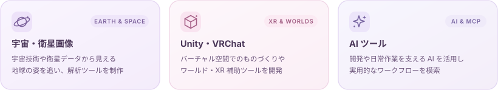
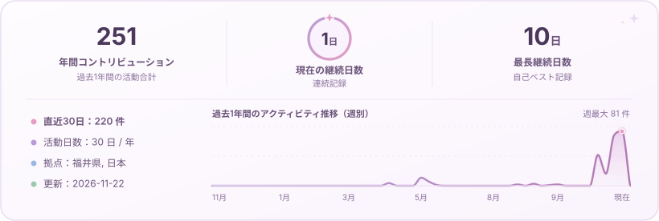

  <strong>日本語</strong> &nbsp;·&nbsp; <a href="https://github.com/r-fallingstar/r-fallingstar/blob/main/README.en.md">English</a> &nbsp;·&nbsp; <a href="https://r-fallingstar.github.io/">Portfolio ↗</a> &nbsp;·&nbsp; <a href="https://snow-moon-works.booth.pm/">BOOTH ↗</a>

  

<h2 align="center">こんにちは、R です 🌠</h2>

  宇宙・衛星画像、Unity / VRChat、AI ツールに関心があります。 
  気になった技術を調べながら、個人開発や実用ツールの試作・配布を行っています。

  <picture>
    <source media="(prefers-color-scheme: dark)" srcset="./assets/focus-ja-dark.svg" />
    <source media="(prefers-color-scheme: light)" srcset="./assets/focus-ja-light.svg" />
    
  </picture>

  <picture>
    <source media="(prefers-color-scheme: dark)" srcset="./assets/tech-stack-dark.svg" />
    <source media="(prefers-color-scheme: light)" srcset="./assets/tech-stack-light.svg" />
    
  </picture>

  <picture>
    <source media="(prefers-color-scheme: dark)" srcset="./assets/divider-dark.svg" />
    <source media="(prefers-color-scheme: light)" srcset="./assets/divider-light.svg" />
    
  </picture>

### ✦ 主な制作物

#### [VRC Asset Manager](https://booth.pm/ja/items/9201818) — *Windows App & Unity VPM Bridge*

VRChat 改変用にダウンロードしたアバター・衣装・髪型・ツール・テクスチャなどを、Windows 上で一括整理・管理できるデスクトップアプリです（基本無料・支援者版あり）。

- ZIP・`.unitypackage`・解凍済みフォルダをまとめて管理し、BOOTH 商品ページやサムネイル画像と紐付けて直感的に探せます。
- ジャンル・ショップ別の整理やタグ・メモ管理に加え、BOOTH 以外の配布物や自作アセットにも対応しています。
- 公式 VPM パッケージ（`com.fallingstar.vrc-asset-manager-bridge`）により、Unity Editor へのワンクリック導入と「導入済みアセット」タブでのビジュアル管理が可能です。

[BOOTH で見る ↗](https://booth.pm/ja/items/9201818) &nbsp;·&nbsp; [Unity VPM 追加ページ ↗](https://r-fallingstar.github.io/VRC-Asset-Manager-vpm/) &nbsp;·&nbsp; [更新履歴・リリースノート ↗](https://github.com/r-fallingstar/VRC-Asset-Manager-updates/releases)

#### [Satellite_Image_Downloader](https://github.com/r-fallingstar/Satellite_Image_Downloader) — *Earth Imagery Studio*

地図上で範囲を指定し、Google Earth Engine 経由で Sentinel-2 や Landsat の光学衛星画像を PC へ取得・保存できる日本語デスクトップアプリです。

- 撮影期間や雲量の上限を設定し、必要な領域を切り出してダウンロードできます。
- 指定期間内の複数シーンを合成（モザイク処理や中央値コンポジット）して取得できます。
- 解析用の GeoTIFF に加え、QGIS 向けの表示スタイル設定（`.qml`）も出力可能です。

※ 現在はプライベートリポジトリのため、閲覧にはアクセス権が必要です。

<table width="100%">
  <tr>
    <td width="50%" valign="top">
      <strong><a href="https://github.com/r-fallingstar/nocturne-planet-poster-atlas">nocturne-planet-poster-atlas</a></strong> 
      Web ツール · HTML / JavaScript  
      VRChat ワールド「Nocturne Planet」の入口掲示用ポスターを、ブラウザ内だけで 9 枚ずつアトラス化し、PNG・JPG・ZIP で書き出せる作成ツール。  
      <a href="https://r-fallingstar.github.io/nocturne-planet-poster-atlas/">Web ツールを開く ↗</a>
    </td>
    <td width="50%" valign="top">
      <strong><a href="https://github.com/r-fallingstar/singularity-setup-wizard">singularity-setup-wizard</a></strong> 
      Windows + Quest Pro · Python  
      Windows と Quest Pro 向けの非公式・日英バイリンガルセットアップウィザード。選択的なファームウェア保護や、ワイヤレス ADB・スリープ・6GHz 補助を案内します。  
      <a href="https://github.com/r-fallingstar/singularity-setup-wizard/releases">リリースを見る ↗</a>
    </td>
  </tr>
</table>

### ✦ 公開ツール・フォーク

| 分野 | リポジトリ | 概要 |
| :--- | :--- | :--- |
| macOS | [**steamac-lite**](https://github.com/r-fallingstar/steamac-lite) | Apple Silicon Mac 上の軽量 VM で ARM64 SteamOS を動かす `steamac` の適応プロファイル版フォーク（[図解ガイド ↗](https://r-fallingstar.github.io/steamac-lite/?lang=ja)） |
| Unity / VRChat | [**unity-mcp-alcom**](https://github.com/r-fallingstar/unity-mcp-alcom) | CoplayDev Unity MCP を ALCOM / VPM 経由で導入・自動更新できるようにした配布用フォーク（[ALCOM 追加ページ ↗](https://r-fallingstar.github.io/unity-mcp-alcom/)） |
| Windows | [**now-playing-taskbar-widget-forAmazonMusic**](https://github.com/r-fallingstar/now-playing-taskbar-widget-forAmazonMusic) | Windows タスクバーの再生情報ウィジェットを Amazon Music（SMTC Bridge 連携）に対応させた非公式フォーク |
| AI / MCP | [**mcp-youtube-transcript**](https://github.com/r-fallingstar/mcp-youtube-transcript) | YouTube 動画の字幕テキストを取得する MCP サーバーのフォーク |

### ✦ BOOTH ショップ

**[Snow Moon Works](https://snow-moon-works.booth.pm/)**

VRChat 向けの 3D アクセサリー（`月女神＜アルテミス＞の星涙`、`星結び` シリーズ、`NIXIE BONBON` などの Modular Avatar / PhysBone 対応アイテム）や、`VRC Asset Manager`・`ポンモバ` などの実用ツールを頒布しています。

[BOOTH ショップを見る ↗](https://snow-moon-works.booth.pm/)

### ✦ 開発アクティビティ

  <picture>
    <source media="(prefers-color-scheme: dark)" srcset="./assets/activity-card-ja-dark.svg" />
    <source media="(prefers-color-scheme: light)" srcset="./assets/activity-card-ja-light.svg" />
    
  </picture>

### ✦ 開発への支援

公開しているツールは、これからも無料で提供していく予定です。 
開発・検証にかかる費用を支えていただけると、継続の大きな助けになります。

  <a href="https://github.com/sponsors/r-fallingstar">
    <picture>
      <source media="(prefers-color-scheme: dark)" srcset="./assets/sponsor-ja-dark.svg" />
      <source media="(prefers-color-scheme: light)" srcset="./assets/sponsor-ja-light.svg" />
      
    </picture>
  </a>

  支援は任意です。個別サポートや機能追加をお約束するものではありません。

  <picture>
    <source media="(prefers-color-scheme: dark)" srcset="./assets/divider-dark.svg" />
    <source media="(prefers-color-scheme: light)" srcset="./assets/divider-light.svg" />
    
  </picture>

  <a href="https://r-fallingstar.github.io/">ポートフォリオサイト ↗</a> &nbsp;·&nbsp; <a href="https://snow-moon-works.booth.pm/">BOOTH（Snow Moon Works）↗</a> &nbsp;·&nbsp; <a href="https://github.com/r-fallingstar?tab=repositories">すべてのリポジトリを見る ↗</a>

  ✧ ˚ · .　ご覧いただきありがとうございます　. · ˚ ✧

